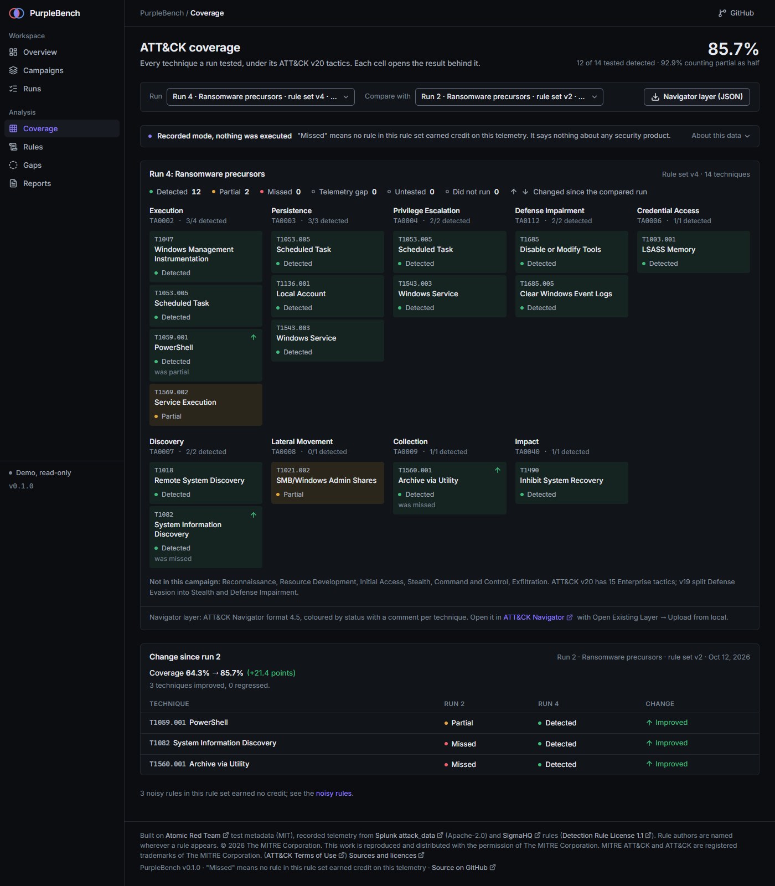
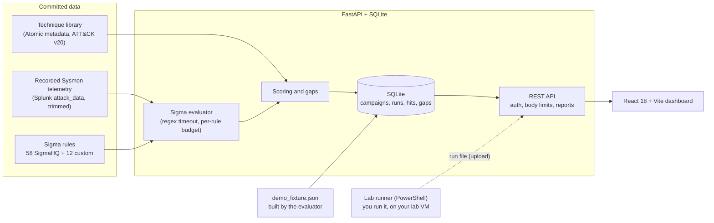

# PurpleBench

Purple-team detection validation for Windows. PurpleBench takes a list of MITRE ATT&CK techniques, replays recorded Sysmon telemetry for each one against a set of Sigma rules, and reports per technique whether a rule fired, with the rule's author shown beside every match. The result is a measured coverage number for **this rule set on this telemetry**, a list of gaps with the telemetry and rule idea that would close each one, and exports (HTML and Markdown reports, an ATT&CK Navigator layer).



## Recorded mode: read this first

> **Everything in the live demo and in a fresh install is *recorded mode*.** No command is executed and no lab is used. The telemetry is Windows Sysmon events that other people recorded when they ran Atomic Red Team tests (Splunk `attack_data`, Apache-2.0), trimmed to each test's time window, plus a benign baseline. PurpleBench evaluates Sigma rules over those events with its own evaluator and scores the result. A technique is **missed** when no rule in the rule set earned credit on that recording. It says nothing about any product, and it is not a statement about your environment.

Live demo: **https://purplebench-demo.vercel.app/**. The hosted demo is recorded mode only, guests are read-only, and its database lives in `/tmp` and resets on a cold start.

## Why measured detection coverage matters

Detection rules are easy to collect and hard to trust. Having a rule is not the same as seeing the behaviour it is meant to catch: a rule can depend on a field the telemetry does not have, fire on benign activity, or never match a real run of the technique. The only way to know is to run the behaviour (or replay a recording of it) and look at what fires.

- Atomic Red Team describes its tests as "small and highly portable detection tests based on MITRE's ATT&CK" ([github.com/redcanaryco/atomic-red-team](https://github.com/redcanaryco/atomic-red-team), MIT), which is what makes this kind of repeatable check possible.
- A vendor report shows why checking matters. Picus Security's Blue Report 2025, which analysed more than 160 million attack simulations run on its own platform by its customers, states that "only 14% of attacks generated alerts" while "logging coverage held steady at 54%" ([press release, 11 August 2025](https://www.picussecurity.com/resource/press-release/picus-launches-blue-report-2025)). That is a vendor's own data and promotional material, not an independent study, and its population is that vendor's customers; read it as an illustration of the gap between logging and alerting, not as a benchmark for any other environment.

PurpleBench does the small, honest version of that check: it names the rule set, names the telemetry, and says what fired.

## Workflow

1. **Pick a campaign**: a list of techniques (two demo campaigns are included). Admins can create more.
2. **Run**: each run scores one rule set version over the recorded telemetry of every technique in the campaign. The four demo runs show coverage rising as rules are added (v1 to v4).
3. **Read the result** per technique: `detected`, `partial`, `missed`, `telemetry_gap`, `untested` or `did_not_run`, with the rules that fired and their authors, time to detect, and the matching events with the matched text highlighted.
4. **Close gaps**: each missed, partial or telemetry-gap technique becomes a gap with a hint (the telemetry or rule that would close it). In the recorded demo, a gap closes when a later run of the same campaign detects the technique. That closing is done by the demo builder only: importing a lab run opens gaps for that run but does not close earlier ones. Admins can record notes, accept a gap and re-open it by hand.
5. **Export**: HTML and Markdown reports and an ATT&CK Navigator layer (format 4.5) per run.
6. **Optional, lab mode**: run the campaign's Atomic tests yourself on a disposable lab VM with the PowerShell runner and upload the run file (see [Lab mode and safety](#lab-mode-and-safety)).

## The dashboard

A dark, table-first React dashboard with a fixed sidebar (a top bar with a menu drawer below 900 px). Pages: **Overview** (coverage score, trend, detection by tactic, open gaps, noisy rules), **Campaigns**, **Runs** (with a run page and a per-technique execution page that shows the matched events), **Coverage** (the ATT&CK matrix with a comparison between runs), **Rules**, **Gaps** and **Reports**. Every page carries a one-line recorded-mode notice that says what "missed" means; the sources and caveats open under "About this data", and the full ATT&CK notice, the dataset credits and the rule-author attribution stay in the footer and on each rule. Type is Inter, bundled with the app, and icons are Lucide; neither is loaded from a CDN (see [THIRD_PARTY.md](THIRD_PARTY.md)).

## The Sigma evaluator and its supported subset

PurpleBench evaluates Sigma rules itself (`backend/purplebench/sigma/`), directly on normalised Windows events, targeting the [Sigma Rules Specification 2.1.0](https://github.com/SigmaHQ/sigma-specification). It implements a documented subset; pySigma is not used.

- Supported: maps and lists of maps, `contains`, `startswith`, `endswith`, `all`, `cased`, `exists`, `windash`, `re` (with `i`, `m`, `s`), wildcards, `null`, conditions with `and`/`or`/`not`, `1 of`/`all of` and their patterns, and the Windows `process_creation`, `registry_set`, `file_event`, `network_connection`, `process_access`, `ps_script`, Security and System log sources. Security 4688 is mapped to `process_creation`.
- A rule outside the subset (for example the `base64offset` and `cidr` modifiers, correlation rules, `fieldref`) loads as `unsupported` with the exact reason. It is never evaluated as "no match". 4 of the 70 bundled rules are unsupported today.
- A rule that cannot see its telemetry (its channel, event id or a field it needs is absent) is a `telemetry_gap`, never "missed".
- `|re` uses the third-party `regex` module with a 50 ms time limit per match and a per-rule budget of timeouts, after a static pattern check, so a catastrophic pattern cannot hang a request.
- The rule set is **58 rules from SigmaHQ** (Detection Rule License 1.1, bundled unmodified) plus **12 custom rules** written for gaps the SigmaHQ set leaves on this telemetry. **Every place a rule match is shown also shows the rule's author**, as the licence requires.

Details: [docs/SIGMA_SUPPORT.md](docs/SIGMA_SUPPORT.md) (the supported subset, hand-written) and [docs/COVERAGE.md](docs/COVERAGE.md) (rule inventory and demo coverage, generated by `python -m purplebench docs` and checked in CI).

## Scoring definitions

- **detected**: a rule tagged with exactly the tested ATT&CK technique fired on its telemetry and is not noisy.
- **partial**: no rule earned `detected` credit, but a clean rule for the parent technique or for a related technique fired, or the only rule that fired for the exact technique (or its parent) was noisy.
- **missed**: no rule earned credit. A noisy rule tagged only for some other technique does not count: it is named in the result's reason but earns nothing.
- **telemetry_gap**: the rules for the technique cannot see this telemetry (missing channel, event id or field). Not a rule failure.
- **untested**: the technique has no usable recorded telemetry in the data set. **T1558.003 (Kerberoasting) is untested**: the trimmed Splunk file has no Kerberoasting events.
- **did_not_run**: a lab test that did not execute. Excluded from the score.
- **Noisy rule**: a rule that also fires on the benign baseline. It never earns `detected`. It can leave a technique `partial` only when it is tagged with exactly that technique or its parent.
- **Coverage score** = detected / tested, where tested excludes `untested` and `did_not_run`. The "partial as half" figure counts each `partial` as 0.5.
- **A best case, not a generalisation.** The 12 custom rules were written for gaps on these same recordings, so the v4 result (22 of 25 techniques, 88%) is a best case on telemetry the rules were tuned against. It shows what this rule set achieves on known recordings, not how it would do on unseen attacks or in another environment.
- **ATT&CK v20.** Technique and tactic IDs are ATT&CK Enterprise v20. v19 split the Defense Evasion tactic into **Stealth** and **Defense Impairment**, and renumbered some techniques (for example T1562.001 is now **T1685**, and T1070.001 is **T1685.005**); the catalog keeps a `dataset_id` alias for the original Splunk folder names.

## Lab mode and safety

> **Lab mode has not yet been run against a real lab.** The runner, the run-file format and the importer are tested statically and with synthetic run files only. Expect rough edges on a first run and treat the first results with care.

Lab mode lets you run the campaign's Atomic Red Team tests on a disposable Windows VM **you own** and import that VM's own Sysmon and Security events. The web app never executes anything, connects to any host or downloads attack tooling. Only `lab/Invoke-PurpleBenchRun.ps1`, run by you, does, and it refuses unless all of this holds:

1. The target is in your local allow-list file (exact names, no wildcards).
2. The target carries the registry marker `HKLM:\SOFTWARE\PurpleBench\LabTarget = 1` that you set on purpose.
3. A destructive-action warning is shown and you type the target name. `-WhatIf` executes nothing and contacts no host.
4. A WinRM `-Credential` is supplied (required for every real run; the script exits 1 without it).
5. Each test is followed by `Invoke-AtomicTest -Cleanup`. Revert the VM snapshot when you are done.

It never downloads anything, never evaluates fetched text and talks WinRM to one target only. CI parses it with the PowerShell AST and applies an **allow-list**: only the commands, .NET calls and parameters the runner needs may appear (native executables, aliases, `&`, dot-sourcing, `-EncodedCommand`, `Invoke-Command -FilePath` and anything else fail), and the gates must be present in the right order. A self-test proves the checker fails. It also guards the runner's structure against edits (no redefined gate functions, no changes to or aliases of the variables the gates use, the two gate functions pinned, no splatting, no environment writes, gates that cannot be skipped). A static check is defence in depth, not a sandbox: read the script before you run it. Setup and details: [lab/README.md](lab/README.md).

## Datasets and licences

| What | Source | Licence | Used for |
|---|---|---|---|
| Recorded Sysmon telemetry | [splunk/attack_data](https://github.com/splunk/attack_data) | Apache-2.0 | 26 techniques, trimmed to each test window, plus a benign baseline |
| Test metadata | [redcanaryco/atomic-red-team](https://github.com/redcanaryco/atomic-red-team) | MIT | Test names, GUIDs and command text, shown for reference only |
| Rules | [SigmaHQ/sigma](https://github.com/SigmaHQ/sigma) release `r2026-07-01` | [Detection Rule License 1.1](https://github.com/SigmaHQ/Detection-Rule-License) | 58 rules, unmodified, author shown on every match |
| Custom rules | this repository, by Andrew T. Price II | DRL 1.1 | 12 rules |
| ATT&CK and Navigator layer | [MITRE ATT&CK](https://attack.mitre.org/) v20, Navigator layer format 4.5 | ATT&CK Terms of Use (notice below) | IDs, names and the exported layer |

**OTRF Security-Datasets are not used.** Their repository's `LICENSE` file is MIT but its README also carries a "GPL-3.0" licence line, and that conflict is unresolved, so none of their data is committed. Splunk `attack_data` has an unambiguous Apache-2.0 licence and covers every selected technique.

Full evidence, URLs and commits: [THIRD_PARTY.md](THIRD_PARTY.md) and [DECISIONS.md](DECISIONS.md).

## Quick start

Python 3.12 or newer and Node 20.19+ or 22.12+ (`package.json` `engines`).

```bash
cd backend
python -m venv .venv
source .venv/bin/activate                             # Linux/macOS
.venv\Scripts\activate                                # Windows (PowerShell: .venv\Scripts\Activate.ps1)
pip install -r requirements-dev.txt
python -m purplebench demo --serve                    # loads the recorded demo, serves http://127.0.0.1:8000 (guest, read-only)

# in a second terminal, from the repository root
npm ci
npm run dev                                           # http://localhost:5173, proxies /api to port 8000
```

Other commands (from `backend/`, with the virtual environment active; otherwise call `.venv/bin/python` or `.venv\Scripts\python`):

```bash
python -m purplebench create-admin      # set the admin login (writes backend/.env); needed to create campaigns or upload runs
python -m purplebench serve             # serve backend/data/purplebench.db (not demo mode)
python -m purplebench catalog --check   # validate the telemetry manifest and technique library
python -m purplebench docs --check      # docs/COVERAGE.md is current
python -m purplebench demo --check      # demo fixture matches a rebuild with the real evaluator
python -m pytest -q -rs
```

### Environment variables

Names only; see [backend/.env.example](backend/.env.example). Real environment variables win over `backend/.env`. A blank value counts as unset.

| Variable | Purpose |
|---|---|
| `PURPLEBENCH_ADMIN_USER` | Admin user name (default `admin`) |
| `PURPLEBENCH_ADMIN_PASSWORD_HASH` | Password hash from `create-admin`. Without it nobody can sign in |
| `PURPLEBENCH_SECRET_KEY` | Signs session tokens; long and random |
| `PURPLEBENCH_SESSION_HOURS` | Session lifetime |
| `PURPLEBENCH_COOKIE_SECURE` | Send the session cookie over HTTPS only (on by default) |
| `PURPLEBENCH_TRUST_PROXY` | Use `X-Forwarded-For` for the client IP (only behind a proxy you control) |
| `PURPLEBENCH_DB` | SQLite database path |
| `PURPLEBENCH_DATA_DIR` | Data directory override |
| `PURPLEBENCH_MAX_UPLOAD_MB` | Run upload cap (32 locally, 4 in demo mode, never above 4 on Vercel) |
| `PURPLEBENCH_DEMO` | Hosted-demo mode: seeded recorded data, guests read-only |
| `PURPLEBENCH_GUEST` | Anonymous read-only access (on in demo mode, off otherwise) |

### Deploy your own demo on Vercel

`vercel.json` and `api/index.py` are set up for it (the live demo above runs on it). The function bundles the `purplebench` package, `backend/data` and `backend/rules` (about 24 MB with dependencies, against Vercel's 500 MB Python limit). Each function instance builds its own SQLite database in `/tmp` from the demo fixture on first use; data routes answer 503 until it exists. By default visitors are read-only guests. A login exists only if the owner sets `PURPLEBENCH_ADMIN_PASSWORD_HASH` and `PURPLEBENCH_SECRET_KEY`; the demo then shows a notice beside admin controls that changes are visible to other visitors until the demo resets. Vercel rejects request bodies over 4.5 MB, so uploads are capped at 4 MB there.

## Architecture



Recorded runs are computed at build time by the real evaluator into `backend/data/demo_fixture.json` (checked in CI); a cold start only loads it. Uploaded lab runs are validated, evaluated and scored on import.

## Security

- No endpoint executes commands, and the web app contacts no lab host. The lab runner is a separate script you run yourself, behind the gates above.
- Telemetry and uploaded run files are untrusted input: Windows Event XML is parsed with `defusedxml` with DTDs refused; run files are size-capped and schema-validated.
- Request bodies are capped (64 KiB for everything except the run upload, which keeps its own cap), with security headers and a strict CSP on every response.
- Admin login uses a salted PBKDF2-SHA256 password hash and a signed, httpOnly, SameSite=Strict session cookie; failed logins are rate-limited per client address. Without admin variables nobody can sign in. All writes need the admin.
- On the hosted demo, admin writes are deliberate and shared: only the owner holds the password, logins are rate-limited, and the `/tmp` database resets on a cold start.
- Sigma `|re` patterns pass a static check and run under a 50 ms time limit with a per-rule budget.
- CI runs `pip-audit`, `npm audit`, gitleaks and the PowerShell static safety check.

To report a vulnerability, open a private security advisory on the repository.

## Tests

Counts from the last full run on Windows with PowerShell available:

- **Backend: 693 pytest tests passed** (0 skipped locally). The tests that run PowerShell are skipped where neither `powershell` nor `pwsh` is on the PATH, and CI runs pytest with `-rs` so any skip is named in the log.
- **Frontend: 47 `node --test` unit tests passed**, plus a production build.
- **PowerShell static safety check**: the runner passes; a self-test of 209 cases (the unchanged runner, 154 appended bypass attempts, 15 inside the remote script blocks, 38 weakened gates, and a fixture file) proves the checker fails on each.
- **Browser smoke test** (`e2e/smoke.mjs`, Playwright with Chrome): guest read-only plus one page per area. Run locally; it runs in CI as a non-blocking job.
- Data checks: `catalog --check`, `docs --check`, `demo --check`.

## Limitations

- **Recorded telemetry from public datasets.** The events are 2020-2022 attack_range recordings. They show what those runs produced, not what your hosts would.
- **A Sigma subset only.** Rules outside it are reported unsupported, not evaluated. Only Windows Sysmon, Security and System sources are modelled.
- **No EDR.** There are no endpoint products, prevention or response in the loop; only Sigma rules over event logs.
- **Coverage means "this rule set on this telemetry".** It is not a product benchmark, not a statement about your environment, and a `detected` result is credit for one recording.
- 26 techniques over 11 tactics; one recording per technique, some only dataset-level links (see `DECISIONS.md`). T1558.003 is untested.
- Lab mode has not yet been run against a real lab.
- `detected` credit follows the rule's ATT&CK tags; tag mistakes upstream carry through.

## Licence

The code is MIT (see [LICENSE](LICENSE)). Third-party content keeps its own licences: Atomic Red Team (MIT), Splunk attack_data (Apache-2.0), SigmaHQ rules (Detection Rule License 1.1), the Sigma specification (public domain), ATT&CK (see below) and the `regex` module (Apache-2.0 and CNRI Python). See [THIRD_PARTY.md](THIRD_PARTY.md).

MITRE ATT&CK is used under the [ATT&CK Terms of Use](https://attack.mitre.org/resources/legal-and-branding/terms-of-use/), which require this notice:

> © 2026 The MITRE Corporation. This work is reproduced and distributed with the permission of The MITRE Corporation.
>
> MITRE ATT&CK and ATT&CK are registered trademarks of The MITRE Corporation.
